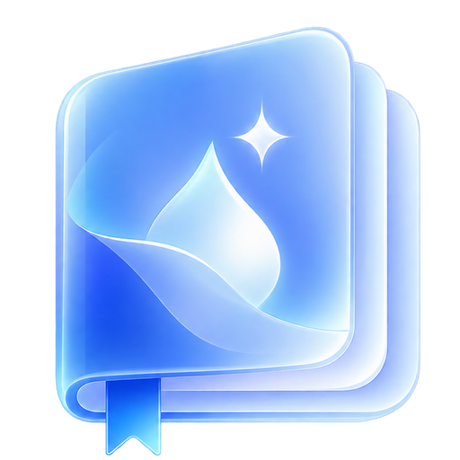
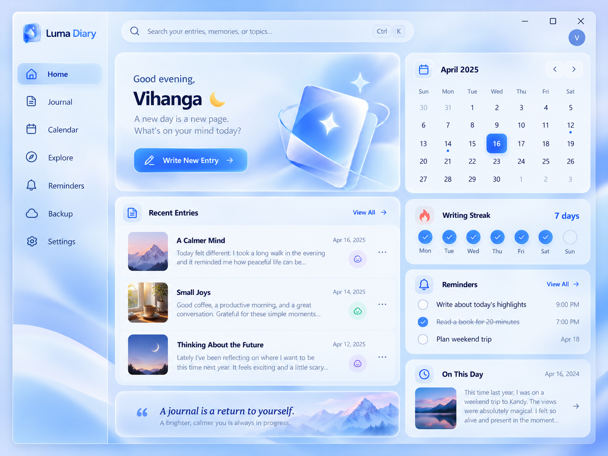

<div align="center">


# Luma Diary · Glass Edition

**A beautiful private place for your everyday moments.**

**v2.0.0 · Windows 11 · Offline-first · Encrypted · 7-tab liquid-glass interface**
</div>

> **Development build — not a Windows-verified public release.** This repository contains the real Electron desktop app source and automated Windows Setup.exe build workflow. An `.exe` is **not included** in the source ZIP. The app is not security-audited or code-signed. Test thoroughly and back up your diary before installing over earlier versions.

## Design preview (concept only)



*The image above is a UI design concept; actual UI is coded with CSS and interactive HTML and may differ in details.*

## What you can do

| Area | Features |
| --- | --- |
| Welcome | Get Started onboarding, create/unlock private diary, import older Native v1.1 journal |
| Home | Glass dashboard with quick write, calendar widget, daily streak, recent entries, reminders and On This Day |
| Journal | Encrypted writing, editing, deleting, searching, tags, moods, entry date, reminders |
| Calendar | Browse a month, select a day to revisit entries |
| Explore | On This Day and writing prompts; Insights view from Explore |
| Reminders | See upcoming scheduled entry reminders; generic local notifications when app is open and unlocked |
| Backup | Encrypted local export/restore; optional Google Drive app-data sync and restore |
| Settings | Ocean Blue, Violet, Rose, Forest, Sunset, Midnight and custom accent; encrypted optional display name; privacy and sync preferences |
| Shortcuts | Ctrl+K search, Ctrl+N new diary, Ctrl+S save, Esc close editor |

**Privacy:** Journal content lives encrypted at rest on your Windows PC using AES-256-GCM with a passphrase-derived scrypt key. Backups to Drive are also encrypted first. There is no built-in Luma account or tracking SDK. However, this is not an audited security guarantee; malware on an unlocked PC remains a risk. If the passphrase is forgotten, there is no recovery service. See [SECURITY.md](SECURITY.md), [PRIVACY.md](PRIVACY.md).

## Installing the real Windows Setup.exe (without PowerShell)

The `.exe` is produced by **electron-builder NSIS**, not a custom PowerShell installer. It uses the standard installer pages, creates application shortcuts and an uninstall option, and opens in an Electron desktop window without requiring Microsoft Edge or WebView2. It still includes its own bundled Chromium runtime.

**Recommended — GitHub Actions on Windows:**

1. Create a GitHub repository and upload **the contents** of this ZIP. Keep `.github/workflows/windows.yml` in that exact directory.
2. Go to the repository's **Actions → Build Windows Installer → Run workflow**.
3. After successful completion, open the run → **Artifacts** → `Luma-Diary-Windows-Setup`.
4. Extract the artifact ZIP to find `Luma-Diary-Glass-Setup-2.0.0.exe`.
5. Install and test on a Windows 11 x64 PC **before** publishing a public GitHub Release.
6. After end-to-end testing, publish a Release `v2.0.0` with the installer and honest release notes.

**Local Windows build:** Install Node.js 22 and run `build-windows-exe.bat` from the extracted project folder. The script runs npm and generates the installer in `dist/`. It does **not** run when someone installs the resulting `.exe`. An internet connection is required for the initial build and dependencies.

**SmartScreen / Defender:** A real unsigned setup file can still be blocked or reported as unrecognized. **Do not disable Defender.** Public distribution should use trusted code-signing and Windows malware testing. A new installer format alone does not bypass Windows security safeguards.

## Data compatibility and safety

- Electron v1.2 stored a Luma vault in Electron's app user data; this v2 keeps the `appId`, app name and encryption format to aim for in-place compatibility. **Do not uninstall/delete the old data before exporting a backup.**
- Native Go/Win32 v1.1 uses a different vault format. When detected on first-run, the import button appears after Get Started. The original vault is not modified.
- New installations show the Welcome / Get Started screen before passphrase setup; existing Electron vaults show Welcome Back, then unlock.
- A manual encrypted local backup is strongly recommended before every update. The new version is **not** Windows 11 runtime verified yet.
- Drive requires a valid Google Cloud OAuth **Desktop** Client ID configured by the publisher. Google sign-in itself temporarily opens the user's external browser (OAuth requirement); journaling never needs one.
- Cloud sync only runs if connected and while Luma is open; Google Drive backup is not an unlimited automated disaster-recovery service. Some cross-device conflict scenarios require user review.

## Build / test

```sh
npm install
npm test
npm start
npm run build:win
```

The app itself works offline after installation. Node/npm are only needed to build from source. Test scripts cover cryptography, wrong passwords, tampering, migration, merge/tombstones, and UI elements. **Automated tests are not a substitute for Windows end-to-end tests or an independent security review.**

### Publishing changes

Use semantic tags like `v2.0.1` and `v2.1.0`, update `package.json` and `CHANGELOG.md`, build and test each release, then attach your signed installer to GitHub Releases. GitHub Actions also builds on pushing `v*` tags.

**License:** MIT · [Sinhala build guide](WINDOWS_BUILD_GUIDE_SI.md) · [Google Drive setup](GOOGLE_DRIVE_SETUP_SI.md) · [Testing checklist](docs/TESTING.md)
